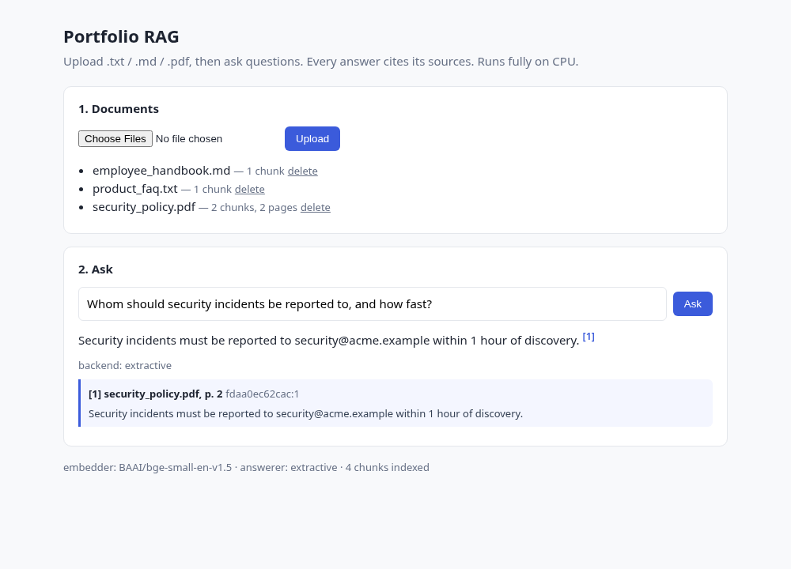
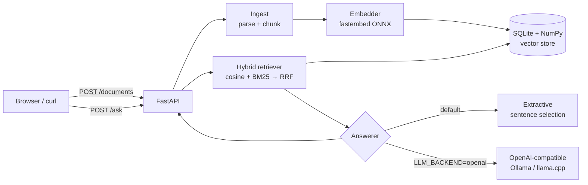

# Portfolio RAG — Knowledge-Base Q&A with Cited Answers (CPU-only)

Upload your documents (`.txt`, `.md`, `.pdf`), ask questions, and get answers where **every claim points back to its source**: document name, page number (for PDFs), chunk id, and the exact supporting sentence.

It runs fully on CPU. It needs no GPU and no paid API, and the default setup doesn't need an LLM at all.



## Features

- **Ingestion**: parses TXT, Markdown, and PDF (page-aware via `pypdf`), and splits text into overlapping chunks on paragraph/sentence boundaries. Each chunk keeps metadata (`doc_name`, `page`, `chunk_id`).
- **Hybrid retrieval**: dense embeddings (`BAAI/bge-small-en-v1.5`, ONNX through `fastembed`, no PyTorch) are combined with **BM25** using weighted Reciprocal Rank Fusion.
- **Cited answers**:
  - `extractive` (default): no model needed. It picks the most relevant sentences (lexical + semantic score) and tags each one with `[n]`. If nothing is relevant enough, it says "not found" instead of guessing.
  - `openai` (opt-in): works with any OpenAI-compatible endpoint, such as **Ollama**, **llama.cpp server**, vLLM, or LM Studio. A citation-enforcing prompt is used, and the system falls back to extractive automatically if the LLM is unreachable.
- **Persistence**: a single SQLite file holds metadata and float32 vectors, and an in-memory NumPy matrix handles search. A file-hash dedup makes re-uploads idempotent.
- **REST API + web demo**: built with FastAPI. The UI is a single static HTML page with no build step.
- **Tests**: 31 fast offline tests use a deterministic hash embedder, plus an optional `slow` integration test with the real model.
- **Docker**: a CPU image plus `docker-compose`. Models live in a mounted volume and are never stored in `~/.cache`.

## Architecture



See [`docs/DESIGN.md`](docs/DESIGN.md) for the full design (in Chinese).

## Quick start (local)

```bash
make install          # creates .venv inside the project and installs pinned deps
make test             # 31 offline tests (< 1 s)
make download-model   # ~65 MB ONNX model -> ./models  (MODEL_DIR)
make test-slow        # integration test with the real model
make run              # http://localhost:8000
make demo             # (another shell) uploads sample_docs/ and asks a question
```

## Quick start (Docker)

```bash
make download-model          # optional: pre-fetch the model into ./models (mounted at /models)
cp .env.example .env
docker compose up -d --build # http://localhost:8000
```

To ship a self-contained image, use `docker build --build-arg BAKE_MODEL=1 .`.

## API

| Method | Path | Description |
|---|---|---|
| `POST` | `/documents` | multipart `file` upload (`.txt/.md/.pdf`, ≤ 20 MB). Returns `doc_id`, `n_chunks`, `pages`, `duplicate` |
| `GET` | `/documents` | List indexed documents |
| `DELETE` | `/documents/{doc_id}` | Remove a document and its chunks |
| `POST` | `/ask` | `{"question": "...", "top_k": 4}` → answer + citations |
| `GET` | `/health` | Status, embedder, answerer, counts |
| `GET` | `/` | Web demo (`/?q=...` auto-asks) |

Example:

```bash
curl -s localhost:8000/ask -H 'Content-Type: application/json' \
  -d '{"question": "Whom should security incidents be reported to, and how fast?"}'
```

```json
{
  "question": "Whom should security incidents be reported to, and how fast?",
  "answer": "Security incidents must be reported to security@acme.example within 1 hour of discovery. [1]",
  "backend": "extractive",
  "citations": [{
    "index": 1, "doc_name": "security_policy.pdf", "page": 2,
    "chunk_id": "fdaa0ec62cac:1",
    "snippet": "Security incidents must be reported to security@acme.example within 1 hour of discovery.",
    "score": 0.016393, "doc_id": "fdaa0ec62cac"
  }]
}
```

## Configuration

All settings are environment variables. See [`.env.example`](.env.example).

| Variable | Default | Notes |
|---|---|---|
| `MODEL_DIR` | `./models` | All model caches (`HF_HOME`, `FASTEMBED_CACHE_PATH`, …) are forced here |
| `DATA_DIR` | `./data` | SQLite index |
| `EMBEDDING_BACKEND` | `fastembed` | `hash` = deterministic, model-free (tests/offline) |
| `EMBEDDING_MODEL` | `BAAI/bge-small-en-v1.5` | Any fastembed-supported model |
| `CHUNK_SIZE` / `CHUNK_OVERLAP` | `800` / `120` | Characters |
| `TOP_K` | `4` | Chunks retrieved per question |
| `HYBRID_ALPHA` | `0.5` | 1 = vector only, 0 = BM25 only |
| `ANSWER_MIN_SCORE` | `0.58` | Below this, the extractive answerer replies "not found" |
| `LLM_BACKEND` | `extractive` | `openai` to use a local LLM server |
| `LLM_BASE_URL` / `LLM_MODEL` | Ollama defaults | e.g. `http://localhost:8080/v1` for llama.cpp |

### Using a local LLM (optional, still free and CPU-only)

```bash
ollama pull qwen2.5:0.5b && ollama serve           # or: llama-server -m model.gguf --port 8080
LLM_BACKEND=openai LLM_BASE_URL=http://localhost:11434/v1 LLM_MODEL=qwen2.5:0.5b make run
```

## Project layout

```
src/rag/
  config.py      settings + forces model caches into MODEL_DIR
  ingest.py      parsing (txt/md/pdf) + boundary-aware chunking with metadata
  embeddings.py  Embedder protocol, FastEmbedEmbedder (ONNX), HashEmbedder (tests)
  store.py       SQLite + NumPy vector store, embedder-signature guard, dedup
  retriever.py   hybrid dense + BM25 retrieval with RRF
  answerer.py    Answerer protocol, ExtractiveAnswerer, OpenAICompatAnswerer
  service.py     orchestration (ingest / ask)
  api.py         FastAPI app factory
  static/        single-file web UI
tests/           pytest (offline fast suite + @slow integration)
scripts/         download_model.py, e2e_demo.sh, make_pdf.py (dependency-free PDF fixtures)
sample_docs/     demo corpus (md, txt, 2-page pdf)
docs/            DESIGN.md, screenshots
```

## Limitations and roadmap

- Scanned PDFs (images) are rejected because there's no OCR yet.
- The extractive answerer quotes the source but doesn't synthesize across documents. For fluent answers, use the LLM backend.
- Brute-force search works comfortably up to about 100k chunks. Beyond that, swap in FAISS behind the `VectorStore` interface.
- Planned: a retrieval eval set (hit@k / MRR) and answer-faithfulness checks, multilingual embeddings (`BAAI/bge-small-zh-v1.5` / `paraphrase-multilingual-MiniLM-L12-v2`, both supported by fastembed), streaming LLM responses, and a re-ranker.

## License

MIT
