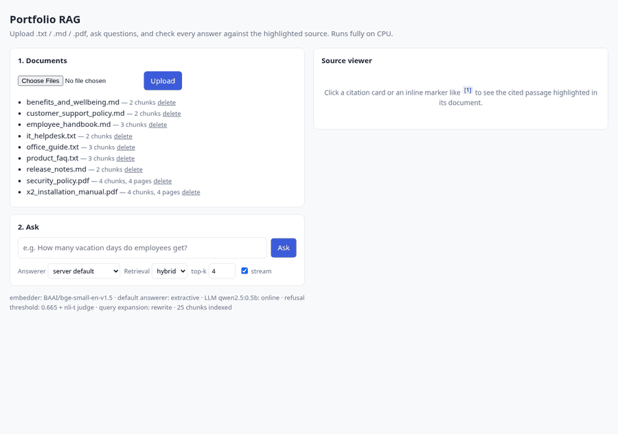
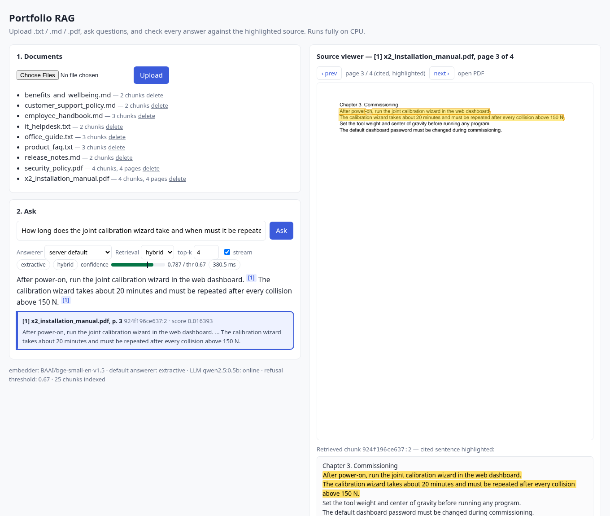
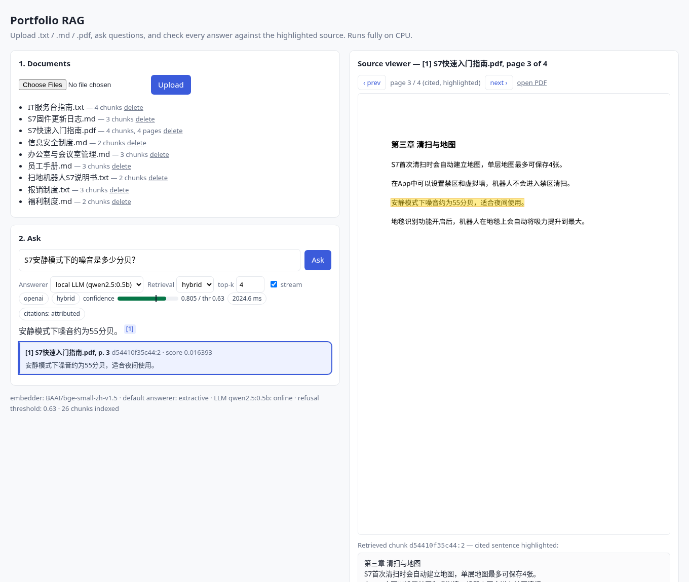
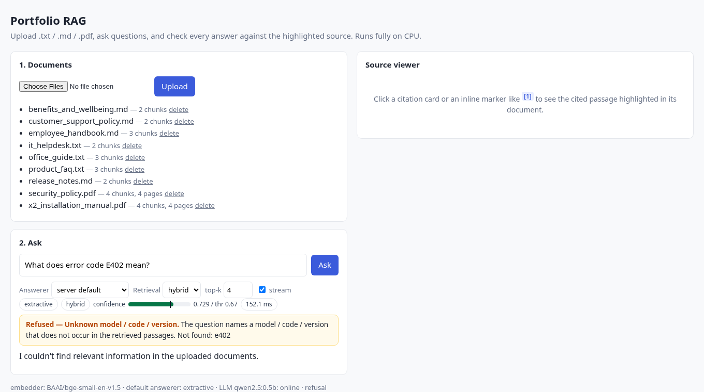
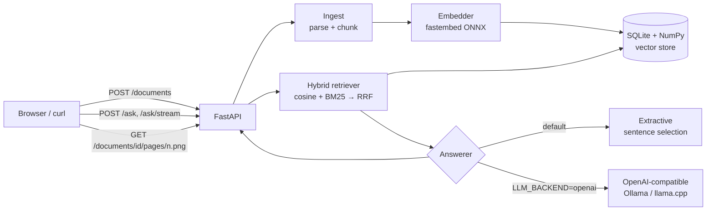

# Portfolio RAG — Knowledge-Base Q&A with Cited Answers (CPU-only)

Upload your documents (`.txt`, `.md`, `.pdf`), ask questions, and get answers where **every claim points back to its source**: document name, page number (for PDFs), chunk id, and the exact supporting sentence.

It runs fully on CPU. It needs no GPU and no paid API, and the default setup doesn't need an LLM at all.



<sub>`docs/img/demo.gif` (16 s) was recorded from headless Chrome by `scripts/record_gif.py`: a cited answer with the PDF page highlighted, a warranty question, and a price question that the answerability judge refuses.</sub>



| Chinese PDF + local LLM (streamed) | Refusal with reason |
|---|---|
|  |  |

## Features

- **Ingestion**: parses TXT, Markdown, and PDF (page-aware via `pypdf`), and splits text into overlapping chunks on paragraph/sentence boundaries. Each chunk keeps metadata (`doc_name`, `page`, `chunk_id`). Chinese PDFs work too: CJK radical code points that some PDF fonts emit (`⼊⻔` instead of `入门`) are folded back before indexing.
- **Hybrid retrieval**: dense embeddings (`BAAI/bge-small-en-v1.5`, ONNX through `fastembed`, no PyTorch) are combined with **BM25** using weighted Reciprocal Rank Fusion. `mode` can be `hybrid`, `vector` or `bm25` per request.
- **English and Chinese**: Chinese uses `BAAI/bge-small-zh-v1.5`. BM25 relies on dependency-free CJK character bigrams instead of jieba, and sentence splitting is CJK-aware.
- **Cited answers**:
  - `extractive` (default): no model needed. It picks the most relevant sentences (IDF-weighted lexical + semantic score), splits multi-part questions so that every part gets its own sentence, and tags each sentence with `[n]`. A **calibrated refusal threshold** makes it answer "not found" instead of guessing.
  - `openai` (opt-in): works with any OpenAI-compatible endpoint, such as **Ollama**, **llama.cpp server**, vLLM, or LM Studio. It adds:
    - an XML-tagged source prompt;
    - a **confidence gate**, which refuses before calling the LLM when retrieval confidence is too low;
    - **post-hoc citation attribution** for when small models forget `[n]` markers;
    - detection of invalid markers;
    - automatic fallback to extractive if the LLM is unreachable.
- **Answerability judge (M4)**: a small ONNX model reads the question together with the candidate sentences and decides whether the evidence actually states what is asked. English uses mDeBERTa-v3 XNLI; Chinese uses bge-reranker-v2-m3. It is combined with the cosine threshold, chosen and calibrated on dev only, and refuses with `not_supported`. See [Evaluation](#evaluation) for the honest trade-off.
- **Query rewriting for paraphrases (M4)**: optional query expansion (`prf`, LLM `rewrite`, or `hyde`) through the local Ollama. Expanded queries are RRF-fused with the original query. The default is chosen on dev: `rewrite`, which falls back silently if the LLM is down.
- **Heading context (M4)**: chunks remember the section heading they start in. Extractive answers prefix it when it carries the asked-for date, version or terms, for example "Version 2.0 (2025-07-01): First release for the X2 hardware."
- **Refusal with a reason**: every refusal carries a machine-readable `refusal_reason` (`low_confidence`, `unknown_identifier`, `llm_refused`, `no_context`, …) and a human-readable `refusal_detail`. Besides the confidence threshold, a cheap rule refuses when the question names a model / error code / version (`X3`, `E402`, `v2.4.0`) that occurs nowhere in the retrieved passages.
- **Evaluation**: 126 English + 122 Chinese questions, split into a frozen **dev** split (used to tune the hybrid weight and the refusal threshold) and a held-out **test** split (headline numbers). `make eval` reports hit@k, MRR, answer/citation accuracy, refusal accuracy and false-refusal rate for dev and test side by side, compares vector/BM25/hybrid, and shows what tuning on test would have given ("oracle"), so the optimism gap is visible. Results go to [`eval/results/REPORT.md`](eval/results/REPORT.md) and JSON.
- **Persistence**: a single SQLite file holds metadata and float32 vectors, and an in-memory NumPy matrix handles search. A file-hash dedup makes re-uploads idempotent.
- **REST API + web demo**: built with FastAPI. The UI is a single static HTML page with no build step:
  - click a citation card or an inline `[n]` marker → the source viewer shows the retrieved chunk with the cited sentence highlighted;
  - for PDFs it also shows the **cited page rendered server-side** (pypdfium2 → PNG, no pdf.js) with the sentence boxed in yellow, plus prev/next page navigation;
  - a confidence meter with the refusal threshold, and the refusal reason when the system declines;
  - per-request switches for the answerer (extractive / local LLM) and retrieval mode (hybrid / vector / BM25), and top-k;
  - **streaming** answers over Server-Sent Events (token-by-token for the LLM).
- **Tests**: 108 fast offline tests use a deterministic hash embedder, a mocked LLM and fake judges. 6 optional `slow` tests use the real English and Chinese models (including Chinese-PDF page citations), the real NLI judge, and a live local LLM (streaming and query rewriting).
- **Docker**: a CPU image plus `docker-compose`. Models live in a mounted volume and are never stored in `~/.cache`. Without a Docker daemon, `scripts/podman.sh` (sudo-free rootless podman) and `scripts/docker_smoke.sh` build the image and smoke-test it.
- **CI**: `.github/workflows/ci.yml`. `scripts/ci_local.sh` runs the same steps locally on a clean copy of the tree.

## Architecture



See [`docs/DESIGN.md`](docs/DESIGN.md) for the full design (in Chinese).

## Quick start (local)

```bash
make install           # creates .venv inside the project and installs pinned deps
make test              # 108 offline tests (~3 s)
make download-models   # bge-small en (~65 MB) + zh (~90 MB) + answerability judges (NLI 1.1 GB, m3 0.55 GB) -> ./models
make test-slow         # integration tests with the real models (+ live LLM if running)
make eval              # dev/test retrieval/answer/refusal metrics -> eval/results/REPORT.md
make run               # http://localhost:8000
make demo              # (another shell) uploads sample_docs/en and asks a question
```

## Quick start (Docker)

```bash
make download-model          # optional: pre-fetch the model into ./models (mounted at /models)
cp .env.example .env
docker compose up -d --build # http://localhost:8000
```

To ship a self-contained image, use `docker build --build-arg BAKE_MODEL=1 .`.

With no Docker daemon (and no sudo), use rootless podman inside the project:

```bash
./scripts/podman.sh install     # podman-static -> tools/ (state, storage and tmp also stay under tools/)
./scripts/docker_smoke.sh       # build, run with ./models mounted read-only, check /health, upload, /ask
./scripts/ci_local.sh           # every step of .github/workflows/ci.yml on a clean copy (act needs Docker)
```

Without the setuid `newuidmap` helper, podman runs in single-UID mode. The image then has to run with `--user 0` (that is the unprivileged host user, not real root), and `chown` during the build falls back to `chmod`. Details in [DESIGN §12.6](docs/DESIGN.md).

## API

| Method | Path | Description |
|---|---|---|
| `POST` | `/documents` | multipart `file` upload (`.txt/.md/.pdf`, ≤ 20 MB). Returns `doc_id`, `n_chunks`, `pages`, `duplicate` |
| `GET` | `/documents` | List indexed documents |
| `DELETE` | `/documents/{doc_id}` | Remove a document, its chunks and its stored file |
| `GET` | `/documents/{doc_id}/file` | The original uploaded file (inline) |
| `GET` | `/documents/{doc_id}/pages/{n}.png?highlight=...&scale=1.5` | PDF page `n` rendered to PNG, with every `highlight` text boxed; `X-Highlights` header = number of boxes |
| `GET` | `/chunks/{chunk_id}` | Full chunk text + doc/page metadata (used by the source viewer) |
| `POST` | `/ask` | `{"question": "...", "top_k": 4, "mode": "hybrid\|vector\|bm25", "answerer": "default\|extractive\|llm"}` → answer, citations, `refused`, `refusal_reason`, `refusal_detail`, `confidence`, `min_score`, `citation_mode`, `latency_ms` |
| `POST` | `/ask/stream` | Same body; Server-Sent Events `retrieval`, `token`…, (`reset`), `done` (= the `/ask` JSON) |
| `GET` | `/health` | Status, embedder, default answerer, LLM model + reachability, threshold, counts |
| `GET` | `/` | Web demo (`/?q=...&answerer=llm&mode=bm25&cite=1` deep links) |

Example:

```bash
curl -s localhost:8000/ask -H 'Content-Type: application/json' \
  -d '{"question": "Whom should security incidents be reported to, and how fast?"}'
```

```json
{
  "question": "Whom should security incidents be reported to, and how fast?",
  "answer": "Security incidents must be reported to security@acme.example within 1 hour of discovery. [1]",
  "backend": "extractive", "refused": false, "refusal_reason": null,
  "confidence": 0.7424, "min_score": 0.67, "mode": "hybrid",
  "citations": [{
    "index": 1, "doc_name": "security_policy.pdf", "page": 2,
    "chunk_id": "fdaa0ec62cac:1",
    "snippet": "Security incidents must be reported to security@acme.example within 1 hour of discovery.",
    "score": 0.016393, "doc_id": "fdaa0ec62cac"
  }]
}
```

## Configuration

All settings are environment variables. See [`.env.example`](.env.example).

| Variable | Default | Notes |
|---|---|---|
| `MODEL_DIR` | `./models` | All model caches (`HF_HOME`, `FASTEMBED_CACHE_PATH`, …) are forced here |
| `DATA_DIR` | `./data` | SQLite index + `files/` (original uploads, for previews) |
| `EMBEDDING_BACKEND` | `fastembed` | `hash` = deterministic, model-free (tests/offline) |
| `EMBEDDING_MODEL` | `BAAI/bge-small-en-v1.5` | Any fastembed-supported model |
| `CHUNK_SIZE` / `CHUNK_OVERLAP` | `800` / `120` | Characters |
| `TOP_K` | `4` | Chunks retrieved per question |
| `HYBRID_ALPHA` | `0.5` | 1 = vector only, 0 = BM25 only (dev-tuned values vary 0.3–0.6, see report) |
| `ANSWER_MIN_SCORE` | per model | Refusal threshold on max sentence cosine; unset = dev-calibrated default (M3 cosine-only: en 0.67 / zh 0.63; with the M4 judge: en 0.665 / zh 0.575) |
| `ANSWERABILITY_JUDGE` | `auto` | `auto` (dev-chosen per embedding model: en `nli-t`, zh `reranker-m3`), `none` (M3 behaviour), `nli`, `nli-t`, `reranker`, `reranker-m3` |
| `ANSWERABILITY_POLICY` / `ANSWERABILITY_MIN` | auto (`and`, dev-calibrated) | `and` = cosine and judge must pass, `or` = either, `replace` = judge only |
| `QUERY_EXPANSION` | `auto` | `auto` (en: `rewrite` with qwen2.5:1.5b; zh: `rewrite` with 0.5b), `off`, `prf`, `rewrite`, `hyde`; uses `LLM_BASE_URL`, falls back to `off` if unreachable |
| `QUERY_EXPANSION_MODEL` / `QUERY_EXPANSION_WEIGHT` | auto | LLM tag; RRF weight of the expansions |
| `HEADING_CONTEXT` | `true` | Prefix section headings in extractive answers when they carry the asked-for date / version |
| `LLM_GATE` | `true` | Refuse before calling the LLM when confidence < threshold |
| `LLM_BACKEND` | `extractive` | `openai` to use a local LLM server |
| `LLM_BASE_URL` / `LLM_MODEL` | Ollama defaults | e.g. `http://localhost:8080/v1` for llama.cpp |

### Using a local LLM (optional, still free and CPU-only)

`scripts/ollama.sh` installs a **user-level, CPU-only Ollama** inside the project. The binary goes to `tools/ollama`, `OLLAMA_MODELS` points to `models/ollama`, and `HOME` points to `tools/home-ollama`. No root is needed, and nothing is written to `~/.ollama`.

```bash
make ollama-install    # downloads the release and keeps only the CPU runtime (~72 MB)
make ollama-up         # starts `ollama serve` on 127.0.0.1:11434
make ollama-pull       # qwen2.5:0.5b (or `./scripts/ollama.sh pull 1.5b`); if the registry is unreachable it
                       # downloads the identical Q4_K_M GGUF from Hugging Face into a temp dir under models/,
                       # verifies its sha256, imports it with `ollama create` and deletes the temp file
make run-llm           # LLM_BACKEND=openai LLM_MODEL=qwen2.5:0.5b
make eval-llm          # adds LLM rows (gated / ungated, test split) to the report; LLM_MODELS=a,b for several
```

Any other OpenAI-compatible server also works, for example `llama-server -m model.gguf --port 8080` with `LLM_BASE_URL=http://localhost:8080/v1`.

### Chinese documents

```bash
EMBEDDING_MODEL=BAAI/bge-small-zh-v1.5 CHUNK_SIZE=200 CHUNK_OVERLAP=30 make run
```

Use a separate `DATA_DIR` per embedding model. The store refuses to mix vector spaces. Even with the default English server you can switch to the local LLM per request (`"answerer": "llm"`, or the UI dropdown); if the LLM server is down the answer falls back to extractive and says so in `backend`.

## Evaluation

| | English | Chinese |
|---|---|---|
| corpus | 9 docs (md, txt, 2 PDFs / 8 pages) | 9 docs (md, txt, 1 PDF / 4 pages with embedded Noto CJK font) |
| questions | 126 (dev 50 / test 76) | 122 (dev 49 / test 73) |
| types | factual 42, paraphrase 36, cross-document 16, unanswerable 32 | factual 42, paraphrase 36, cross-document 14, unanswerable 30 |

Questions are labelled with `(document, evidence substring)`, so labels survive any chunking change. Unanswerable questions are mostly **near misses** — they mention real entities but ask for a fact the documents don't contain ("purchase price of the RoboArm X2", "vacation days for part-time employees", "error code E402"). The split is stratified by type, deterministic, frozen in `eval/datasets/{lang}.{dev,test}.jsonl`, and a test checks the files match `scripts/split_dataset.py`. **The hybrid weight and the refusal threshold are tuned on dev only; test is never used for tuning.** Numbers below: test, with dev in brackets; CPU only, top_k=4, chunk 800, from [`eval/results/REPORT.md`](eval/results/REPORT.md).

**Retrieval** (answerable questions)

| lang | mode | hit@1 | hit@5 | MRR |
|---|---|---|---|---|
| en | vector | 78.9 (75.7) | 96.5 (97.3) | 0.858 (0.851) |
| en | BM25 | 77.2 (81.1) | 84.2 (91.9) | 0.808 (0.856) |
| en | hybrid (α=0.3, dev-tuned) | 78.9 (83.8) | 91.2 (97.3) | 0.848 (0.892) |
| zh | vector | 74.5 (81.1) | 98.2 (100) | 0.851 (0.883) |
| zh | BM25 (char bigrams) | 89.1 (81.1) | 96.4 (97.3) | 0.930 (0.877) |
| zh | **hybrid (α=0.5, dev-tuned)** | **89.1 (91.9)** | **100 (100)** | **0.941 (0.943)** |

**Answers** (refusal threshold calibrated on dev: en 0.67, zh 0.63)

| lang | answerer | answer acc | citation acc | refusal acc | false refusal | p50 |
|---|---|---|---|---|---|---|
| en | extractive | 66.7 (78.4) | 100 (96.9) | 42.1 (69.2) | 29.8 (13.5) | 76 ms |
| en | qwen2.5:0.5b + gate | 45.6 | 87.2 | 47.4 | 31.6 | 1.0 s |
| en | qwen2.5:0.5b, no gate | 64.9 | 87.3 | 5.3 | 3.5 | 1.0 s |
| en | qwen2.5:1.5b + gate | 61.4 | 89.7 | 57.9 | 31.6 | 2.1 s |
| en | qwen2.5:1.5b, no gate | **75.4** | 75.9 | 31.6 | 5.3 | 1.6 s |
| zh | extractive | 81.8 (81.1) | 100 (100) | 66.7 (75.0) | 16.4 (16.2) | 62 ms |
| zh | qwen2.5:0.5b + gate | 65.5 | 91.3 | 66.7 | 16.4 | 1.2 s |
| zh | qwen2.5:0.5b, no gate | 69.1 | 87.3 | 0.0 | 0.0 | 1.1 s |
| zh | qwen2.5:1.5b + gate | 69.1 | 90.9 | 66.7 | 20.0 | 1.7 s |
| zh | qwen2.5:1.5b, no gate | **85.5** | 96.2 | 22.2 | 3.6 | 1.6 s |

LLM rows are test only (dev isn't needed: nothing is tuned for them).

What the held-out split shows:
- **The M2 numbers were optimistic.** On the old 44-question set, calibrated on itself, extractive English scored 88.2 answer accuracy and 5.9 % false refusals. On the new held-out test it is 66.7 and 29.8 %. Most of the drop is colloquial paraphrases ("Can I charge my electric car at the office?") whose best-sentence cosine (0.55–0.66) sits *below* the near-miss unanswerables (0.67–0.85).
- **A single cosine threshold can't separate near misses from paraphrases.** Even the threshold you'd pick by tuning on test ("oracle", 0.745) only reaches 68 % balanced accuracy in English (82.6 % in Chinese). Dev-tuned: 56 % en, 75 % zh. This is a limit of the signal, not of the calibration.
- The unknown-identifier rule adds +5 points balanced accuracy on English test (50.9 → 56.1) at no false-refusal cost. On Chinese it's within noise (77.0 → 75.2; one unanswerable question ≈ 5.6 points).
- Hybrid is clearly best for Chinese. For English, dense-only retrieval is as good as hybrid on test; dev picked α=0.3, which didn't transfer. The alpha sweep is flat within ±0.02 MRR, so the shipped default stays 0.5.
- Ungated `qwen2.5:1.5b` gives the best answer accuracy in both languages but almost never refuses. The gate makes it refuse, but it inherits the gate's false refusals. Extractive remains the only option with 100 % citation accuracy and sub-100 ms latency.
- The test splits have 57/55 answerable and 19/18 unanswerable questions, so 1 question ≈ 1.8 points of answer accuracy and ≈ 5.3–5.6 points of refusal accuracy.

The tables above are the M3 baseline (cosine threshold). M4 results follow; full tables are in REPORT.md sections 5–7 and [DESIGN §12](docs/DESIGN.md).

**Answerability judge (M4).** Each variant's thresholds are calibrated on dev; the default is the variant with the best dev balanced accuracy.

| lang | refusal rule | dev bal. acc | test refusal acc | test false refusal | test bal. acc | test answer acc | extra latency (p50) |
|---|---|---|---|---|---|---|---|
| en | M3: cosine 0.67 + identifier rule | 77.9 | 42.1 | 29.8 | 56.1 | **66.7** | – |
| en | **M4 default: cosine AND `nli-t` (mDeBERTa XNLI fp32)** | 81.1 | **94.7** | 56.1 | 69.3 | 42.1 | +103 ms |
| en | cosine AND `reranker-m3` | 79.9 | 78.9 | 38.6 | **70.2** | 57.9 | +155 ms |
| zh | M3: cosine 0.63 + identifier rule | 79.4 | 66.7 | 16.4 | 75.2 | 81.8 | – |
| zh | **M4 default: cosine AND `reranker-m3` (bge-reranker-v2-m3 uint8)** | 86.3 | 61.1 | **5.5** | **77.8** | **92.7** | +161 ms |

- The judges separate answerable from unanswerable questions much better than cosine. Test ROC AUC: en cosine 0.59 vs NLI 0.83; zh cosine 0.80 vs NLI 0.88 / m3 0.88.
- **Chinese: clear win.** Answer accuracy rises from 81.8 to 92.7 and false refusals drop from 16.4 to 5.5.
- **English: the dev-chosen setting is a bad product trade-off.** It refuses 94.7 % of unanswerable questions but also 56 % of answerable ones, so answer accuracy drops from 66.7 to 42.1. The selection criterion (balanced accuracy on only 13 dev unanswerables) favours refusing. It was not changed after looking at test. `ANSWERABILITY_JUDGE=none` restores the M3 behaviour.
- One concrete cause: the judge reads the bare sentence without its heading, so "When was the first X2 firmware released?" is refused even though the heading-context answer contains the date. See the roadmap.

**Query rewriting for paraphrases (M4)** (hybrid retrieval, test; the default is chosen on dev MRR)

| lang | expansion | test hit@1 | test MRR | **paraphrase hit@1** | **paraphrase MRR** | extra latency p50 / p95 |
|---|---|---|---|---|---|---|
| en | off (M3) | 78.9 | 0.848 | 50.0 | 0.635 | – |
| en | **`rewrite` qwen2.5:1.5b (default)** | 82.5 | 0.875 | **59.1** | **0.708** | 508 / 1427 ms |
| en | `hyde` qwen2.5:1.5b | 80.7 | 0.874 | 54.5 | 0.696 | 732 / 1564 ms |
| en | `prf` (no model) | 63.2 | 0.748 | 45.5 | 0.600 | 5 / 7 ms |
| zh | off (M3) | 89.1 | 0.941 | 86.4 | 0.932 | – |
| zh | **`rewrite` qwen2.5:0.5b (default)** | 89.1 | 0.941 | 86.4 | 0.932 | 196 / 311 ms |

For English paraphrases, hit@1 goes from 50 % to 59 % (+2 of 22 questions) at about +0.5 s per question. For Chinese, the dev-chosen rewrite changes nothing on test. `hyde` 1.5b would have been best there (MRR 0.952), but dev didn't pick it.

**Heading context (M4).** English dev answer accuracy goes from 78.4 to 81.1 (the cross-document question about the first X2 firmware now carries `2025-07-01`). English test and Chinese are unchanged (4 and 0 answers gained a heading, none flipped). Few questions depend on headings.

**Optimism bias, M2 → M3 → M4** (extractive answerer, end-to-end with each milestone's defaults)

| | evaluated on | en answer acc / false refusal | zh answer acc / false refusal |
|---|---|---|---|
| M2 | 44 en / 26 zh questions, threshold calibrated on the same questions | 88.2 / 5.9 | 89.5 / 10.5 |
| M3 | held-out test (dev in brackets) | 66.7 / 29.8 (78.4 / 13.5) | 81.8 / 16.4 (81.1 / 16.2) |
| M4 | held-out test (dev in brackets) | 40.4 / 57.9 (59.5 / 40.5) | 92.7 / 5.5 (89.2 / 10.8) |

M2's numbers were self-calibrated and optimistic. M3 exposed this with a held-out split. M4 shows the gap is still there whenever several knobs are chosen on a small dev set: the English judge's balanced accuracy drops from 81.1 on dev to 69.3 on test. The Chinese improvement does transfer.

## Project layout

```
src/rag/
  config.py      settings + forces model caches into MODEL_DIR
  ingest.py      parsing (txt/md/pdf) + boundary-aware chunking with metadata
  text.py        tokenizer (EN stemming, CJK bigrams), stop-words, CJK-aware sentence splitter
  embeddings.py  Embedder protocol, FastEmbedEmbedder (ONNX), HashEmbedder (tests)
  store.py       SQLite + NumPy vector store, embedder-signature guard, dedup
  retriever.py   hybrid dense + BM25 retrieval with RRF
  answerer.py    Answerer protocol, ExtractiveAnswerer (+ judge policies, heading context), OpenAICompatAnswerer
  answerability.py  NLI / cross-encoder answerability judges (ONNX)
  query.py       query expansion: PRF / LLM rewrite / HyDE with cache + circuit breaker
  service.py     orchestration (ingest / ask / ask_stream, stored files, answerer switch)
  pdfview.py     server-side PDF page rendering + highlight boxes (pypdfium2 + Pillow)
  eval.py        evaluation harness (python -m rag.eval); eval_ext.py = M4 blocks (judges, expansion, headings)
  api.py         FastAPI app factory
  static/        single-file web UI
tests/           pytest (offline fast suite + @slow integration)
scripts/         download_model.py, e2e_demo.sh, make_pdf.py / make_zh_pdf.py (sample PDFs), split_dataset.py,
                 screenshot.py / record_gif.py (headless Chrome via DevTools), ollama.sh (local LLM),
                 podman.sh / docker_smoke.sh (rootless container build + smoke test), ci_local.sh (CI steps locally)
sample_docs/     en/ (md, txt, 2 PDFs) and zh/ (md, txt, 1 Chinese PDF) demo corpora
eval/            authoring/ (question sources), datasets/{en,zh}.{dev,test}.jsonl (frozen), results/ (JSON + REPORT.md)
docs/            DESIGN.md, screenshots
```

## Limitations and roadmap

- **English refusal is still the weakest part.** The NLI judge separates the classes far better than cosine (test AUC 0.83 vs 0.59), but the dev-chosen operating point refuses too much. Next steps:
  - feed the judge the heading-prefixed sentence;
  - choose thresholds under a false-refusal constraint (for example ≤ the M3 rate on dev);
  - grow the dev set's unanswerable questions (13 is too few to tune two thresholds).
- English paraphrase retrieval improved (hit@1 50 → 59 %) but needs the local LLM and adds about 0.5 s. A stronger embedding model is the other route.
- **int8 ONNX models are unsafe on this AMX VM.** onnxruntime's AMX int8 GEMM returns random results when tile state isn't preserved (onnxruntime #33247), so the judges use fp32 / uint8 weights. The bge-small embedders are unaffected; this was verified bit-for-bit.
- Scanned PDFs (images) are rejected because there's no OCR yet.
- PDF highlight boxes come from text search on the page. If a cited sentence was hyphenated across lines in the PDF, it may not be boxed (the chunk text is still highlighted).
- Datasets were written by the author for synthetic sample documents. Use them for relative comparisons, not as absolute quality claims.

## License

MIT
