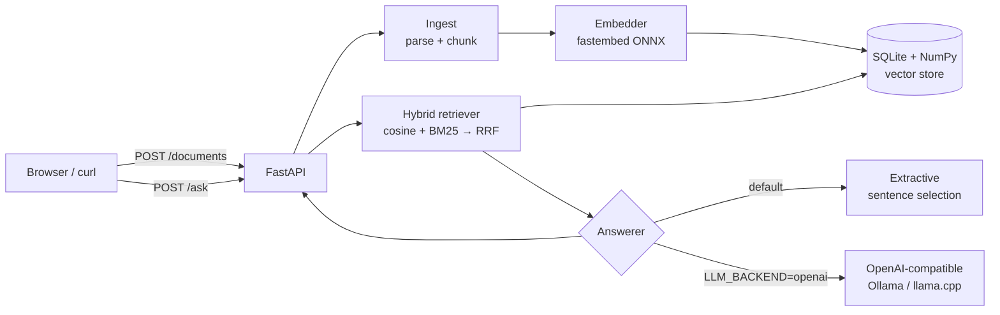

# Portfolio RAG — Knowledge-Base Q&A with Cited Answers (CPU-only)

Upload your documents (`.txt`, `.md`, `.pdf`), ask questions, and get answers where **every claim points back to its source**: document name, page number (for PDFs), chunk id, and the exact supporting sentence.

It runs fully on CPU. It needs no GPU and no paid API, and the default setup doesn't need an LLM at all.


## Features

- **Ingestion**: parses TXT, Markdown, and PDF (page-aware via `pypdf`), and splits text into overlapping chunks on paragraph/sentence boundaries. Each chunk keeps metadata (`doc_name`, `page`, `chunk_id`).
- **Hybrid retrieval**: dense embeddings (`BAAI/bge-small-en-v1.5`, ONNX through `fastembed`, no PyTorch) are combined with **BM25** using weighted Reciprocal Rank Fusion. `mode` can be `hybrid`, `vector` or `bm25` per request.
- **English and Chinese**: Chinese uses `BAAI/bge-small-zh-v1.5`. BM25 relies on dependency-free CJK character bigrams instead of jieba, and sentence splitting is CJK-aware.
- **Cited answers**:
  - `extractive` (default): no model needed. It picks the most relevant sentences (IDF-weighted lexical + semantic score), splits multi-part questions so that every part gets its own sentence, and tags each sentence with `[n]`. A **calibrated refusal threshold** makes it answer "not found" instead of guessing.
  - `openai` (opt-in): works with any OpenAI-compatible endpoint, such as **Ollama**, **llama.cpp server**, vLLM, or LM Studio. It adds:
    - an XML-tagged source prompt;
    - a **confidence gate**, which refuses before calling the LLM when retrieval confidence is too low;
    - **post-hoc citation attribution** for when small models forget `[n]` markers;
    - detection of invalid markers;
    - automatic fallback to extractive if the LLM is unreachable.
- **Evaluation**: `make eval` reports hit@k, MRR, answer/citation accuracy, refusal accuracy and false-refusal rate, compares vector/BM25/hybrid, and calibrates the refusal threshold. Results go to [`eval/results/REPORT.md`](eval/results/REPORT.md) and JSON.
- **Persistence**: a single SQLite file holds metadata and float32 vectors, and an in-memory NumPy matrix handles search. A file-hash dedup makes re-uploads idempotent.
- **REST API + web demo**: built with FastAPI. The UI is a single static HTML page with no build step.
- **Tests**: 60 fast offline tests use a deterministic hash embedder and a mocked LLM. 3 optional `slow` tests use the real English and Chinese models and a live local LLM.
- **Docker**: a CPU image plus `docker-compose`. Models live in a mounted volume and are never stored in `~/.cache`.

## Architecture



See [`docs/DESIGN.md`](docs/DESIGN.md) for the full design (in Chinese).

## Quick start (local)

```bash
make install           # creates .venv inside the project and installs pinned deps
make test              # 60 offline tests (~1 s)
make download-models   # bge-small en (~65 MB) + zh (~90 MB) ONNX models -> ./models (MODEL_DIR)
make test-slow         # integration tests with the real models (+ live LLM if running)
make eval              # retrieval/answer/refusal metrics -> eval/results/REPORT.md
make run               # http://localhost:8000
make demo              # (another shell) uploads sample_docs/en and asks a question
```

## Quick start (Docker)

```bash
make download-model          # optional: pre-fetch the model into ./models (mounted at /models)
cp .env.example .env
docker compose up -d --build # http://localhost:8000
```

To ship a self-contained image, use `docker build --build-arg BAKE_MODEL=1 .`.

## API

| Method | Path | Description |
|---|---|---|
| `POST` | `/documents` | multipart `file` upload (`.txt/.md/.pdf`, ≤ 20 MB). Returns `doc_id`, `n_chunks`, `pages`, `duplicate` |
| `GET` | `/documents` | List indexed documents |
| `DELETE` | `/documents/{doc_id}` | Remove a document and its chunks |
| `POST` | `/ask` | `{"question": "...", "top_k": 4, "mode": "hybrid"}` → answer, citations, `refused`, `confidence`, `citation_mode`, `latency_ms` |
| `GET` | `/health` | Status, embedder, answerer, counts |
| `GET` | `/` | Web demo (`/?q=...` auto-asks) |

Example:

```bash
curl -s localhost:8000/ask -H 'Content-Type: application/json' \
  -d '{"question": "Whom should security incidents be reported to, and how fast?"}'
```

```json
{
  "question": "Whom should security incidents be reported to, and how fast?",
  "answer": "Security incidents must be reported to security@acme.example within 1 hour of discovery. [1]",
  "backend": "extractive",
  "citations": [{
    "index": 1, "doc_name": "security_policy.pdf", "page": 2,
    "chunk_id": "fdaa0ec62cac:1",
    "snippet": "Security incidents must be reported to security@acme.example within 1 hour of discovery.",
    "score": 0.016393, "doc_id": "fdaa0ec62cac"
  }]
}
```

## Configuration

All settings are environment variables. See [`.env.example`](.env.example).

| Variable | Default | Notes |
|---|---|---|
| `MODEL_DIR` | `./models` | All model caches (`HF_HOME`, `FASTEMBED_CACHE_PATH`, …) are forced here |
| `DATA_DIR` | `./data` | SQLite index |
| `EMBEDDING_BACKEND` | `fastembed` | `hash` = deterministic, model-free (tests/offline) |
| `EMBEDDING_MODEL` | `BAAI/bge-small-en-v1.5` | Any fastembed-supported model |
| `CHUNK_SIZE` / `CHUNK_OVERLAP` | `800` / `120` | Characters |
| `TOP_K` | `4` | Chunks retrieved per question |
| `HYBRID_ALPHA` | `0.5` | 1 = vector only, 0 = BM25 only |
| `ANSWER_MIN_SCORE` | per model (0.64) | Refusal threshold on max sentence cosine; unset = calibrated per-model default |
| `LLM_GATE` | `true` | Refuse before calling the LLM when confidence < threshold |
| `LLM_BACKEND` | `extractive` | `openai` to use a local LLM server |
| `LLM_BASE_URL` / `LLM_MODEL` | Ollama defaults | e.g. `http://localhost:8080/v1` for llama.cpp |

### Using a local LLM (optional, still free and CPU-only)

`scripts/ollama.sh` installs a **user-level, CPU-only Ollama** inside the project. The binary goes to `tools/ollama`, `OLLAMA_MODELS` points to `models/ollama`, and `HOME` points to `tools/home-ollama`. No root is needed, and nothing is written to `~/.ollama`.

```bash
make ollama-install    # downloads the release and keeps only the CPU runtime (~72 MB)
make ollama-up         # starts `ollama serve` on 127.0.0.1:11434
make ollama-pull       # qwen2.5:0.5b; falls back to importing the identical Q4_K_M GGUF from Hugging Face
make run-llm           # LLM_BACKEND=openai LLM_MODEL=qwen2.5:0.5b
make eval-llm          # adds LLM rows (gated / ungated) to the report
```

Any other OpenAI-compatible server also works, for example `llama-server -m model.gguf --port 8080` with `LLM_BASE_URL=http://localhost:8080/v1`.

### Chinese documents

```bash
EMBEDDING_MODEL=BAAI/bge-small-zh-v1.5 CHUNK_SIZE=200 CHUNK_OVERLAP=30 make run
```

Use a separate `DATA_DIR` per embedding model. The store refuses to mix vector spaces.

## Evaluation

There are 44 English and 26 Chinese questions in `eval/datasets/*.jsonl`, of four types: factual, paraphrased, cross-document and unanswerable. They are labelled with `(document, evidence substring)`, so the labels survive any chunking change. Excerpt from [`eval/results/REPORT.md`](eval/results/REPORT.md), CPU only, top_k=4:

| lang | retrieval (chunk) | hit@1 | hit@3 | hit@5 | MRR |
|---|---|---|---|---|---|
| en | vector (800) | 70.6 | 97.1 | 100 | 0.831 |
| en | BM25 (800) | 76.5 | 85.3 | 88.2 | 0.811 |
| en | **hybrid (800)** | 70.6 | 97.1 | 100 | **0.836** |
| zh | vector (200) | 84.2 | 100 | 100 | 0.912 |
| zh | BM25 bigram (200) | 89.5 | 100 | 100 | 0.939 |
| zh | **hybrid (200)** | 89.5 | 100 | 100 | **0.947** |

| lang | answerer | answer acc | citation acc | refusal acc | false refusal | p50 latency |
|---|---|---|---|---|---|---|
| en | **extractive** | **88.2** | **100** | 70.0 | 5.9 | 83 ms |
| en | qwen2.5:0.5b + gate | 47.1 | 82.8 | 80.0 | 14.7 | 1.1 s |
| en | qwen2.5:0.5b, no gate | 55.9 | 80.6 | 20.0 | 8.8 | 1.0 s |
| en | qwen2.5:1.5b + gate | 70.6 | 90.6 | 70.0 | 5.9 | 1.9 s |
| zh | **extractive** | **89.5** | **100** | **100** | 10.5 | 69 ms |
| zh | qwen2.5:0.5b + gate | 52.6 | 94.1 | 100 | 10.5 | 0.5 s |
| zh | qwen2.5:0.5b, no gate | 52.6 | 89.5 | 0.0 | 0.0 | 0.6 s |
| zh | qwen2.5:1.5b + gate | 68.4 | 81.2 | 100 | 15.8 | 0.7 s |

Takeaways:
- On CPU, the model-free extractive answerer is the most accurate and roughly 15× faster.
- Sub-1B local LLMs produce more fluent text but make more mistakes, and they almost never refuse on their own. The retrieval-confidence gate is what makes them safe to use.
- The refusal threshold uses **max sentence-question cosine** as the signal. Calibration found 0.63–0.64 for both bge-small models, so 0.64 is the shipped default. Lexical overlap was dropped from the signal because it inflated scores for questions that only name a known entity, such as "price of the RoboArm X2".
- A single multilingual model (`paraphrase-multilingual-MiniLM-L12-v2`) works for both languages but trails `bge-small-en` on English: 79.4 vs 88.2 answer accuracy.
- The datasets are small, so 1 question equals 2.9 points (en) or 5.3 points (zh). Read the differences accordingly.

## Project layout

```
src/rag/
  config.py      settings + forces model caches into MODEL_DIR
  ingest.py      parsing (txt/md/pdf) + boundary-aware chunking with metadata
  text.py        tokenizer (EN stemming, CJK bigrams), stop-words, CJK-aware sentence splitter
  embeddings.py  Embedder protocol, FastEmbedEmbedder (ONNX), HashEmbedder (tests)
  store.py       SQLite + NumPy vector store, embedder-signature guard, dedup
  retriever.py   hybrid dense + BM25 retrieval with RRF
  answerer.py    Answerer protocol, ExtractiveAnswerer, OpenAICompatAnswerer
  service.py     orchestration (ingest / ask)
  eval.py        evaluation harness (python -m rag.eval)
  api.py         FastAPI app factory
  static/        single-file web UI
tests/           pytest (offline fast suite + @slow integration)
scripts/         download_model.py, e2e_demo.sh, make_pdf.py (PDF fixtures), ollama.sh (local LLM)
sample_docs/     en/ (md, txt, 4-page pdf) and zh/ (md, txt) demo corpora
eval/            datasets/{en,zh}.jsonl, results/ (JSON + REPORT.md)
docs/            DESIGN.md, screenshots
```

## Limitations and roadmap

- Scanned PDFs (images) are rejected because there's no OCR yet. Chinese PDFs are untested because the sample PDF generator only supports Latin fonts.
- The extractive answerer quotes sentences, so context that lives only in headings (for example a release date in a `## Version` heading) is lost.
- Refusal relies on one cosine threshold. Near-miss questions such as "price of the RoboArm X2" can still slip through at about 0.77 confidence.
- The evaluation set is small and the thresholds were calibrated on it, so it needs a held-out split and more questions.
- Next: citation click-to-highlight and PDF page preview in the UI, streaming LLM output, a held-out eval split, and a heading-aware context for extractive answers.

## License

MIT
