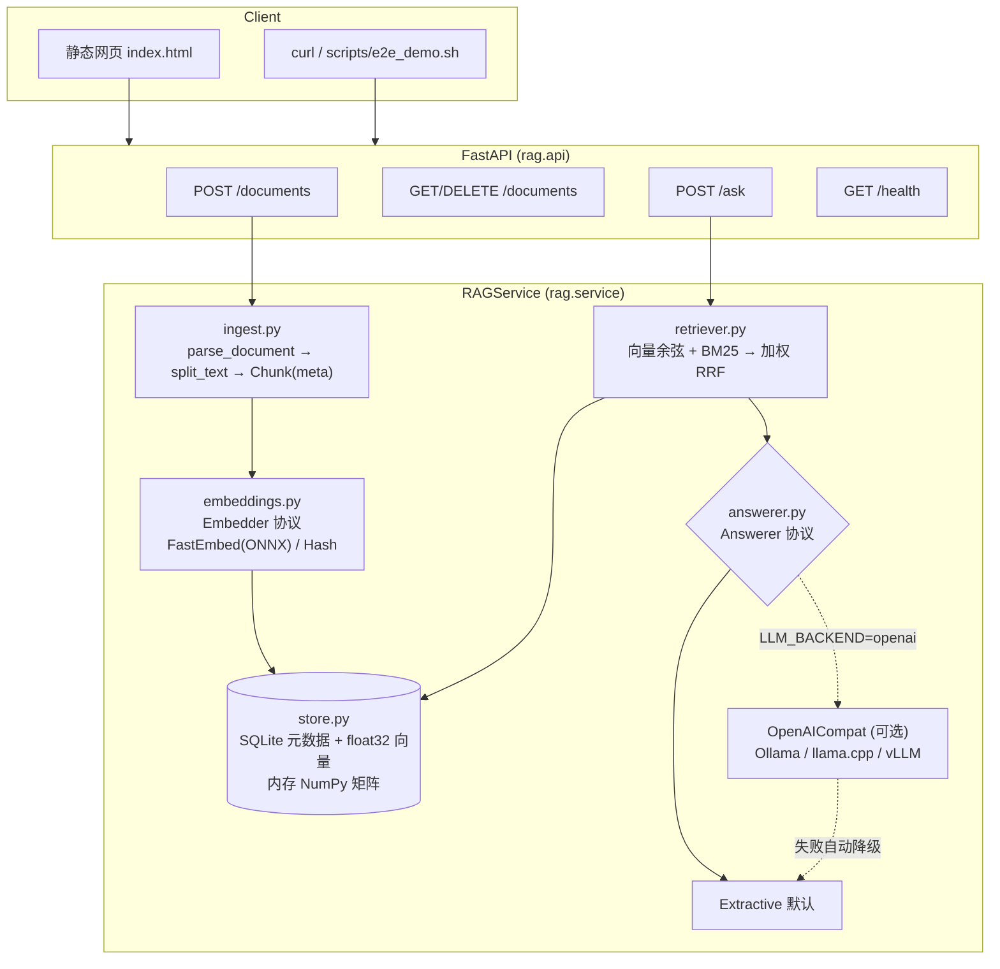

# RAG 知识库问答系统：技术方案 (v0.1)

> AI 作品集项目 #1。目标是一个**纯 CPU、零付费 API、可离线**的 RAG 问答系统，回答必须带可核验的引用（文档名 + 页码 + 原句）。

## 1. 目标与约束

| 维度 | 要求 |
|---|---|
| 功能 | 上传 txt/md/pdf；问答结果带引用（文档名、页码、chunk id、支撑原句）；网页 demo；REST API |
| 工程 | Docker（CPU）、pytest、CI 配置、英文 README |
| 约束 | 不用 GPU；不用付费 API；模型只放 `MODEL_DIR`（默认 `./models`），不进 `~/.cache`；虚拟环境在项目内 `.venv` |
| 非目标（v0.1） | OCR、多租户和鉴权、海量（>100 万 chunk）检索、流式输出 |

## 2. 架构



## 3. 模块划分

| 模块 | 职责 | 关键点 |
|---|---|---|
| `config.py` | pydantic-settings 读取环境变量和 `.env` | `apply_model_cache_env()` 把 HF_HOME / HF_HUB_CACHE / FASTEMBED_CACHE_PATH / SENTENCE_TRANSFORMERS_HOME 全部指向 `MODEL_DIR` |
| `ingest.py` | 解析和分块 | PDF 按页解析，保留页码；分块优先在段落、句子、词边界切分，带 overlap，重叠起点对齐到句首；每个 chunk 带 `doc_id/doc_name/chunk_index/page/start_char` |
| `embeddings.py` | 向量化 | `Embedder` 协议；`FastEmbedEmbedder`（bge-small-en-v1.5，384 维，ONNX 量化版，约 65MB）；`HashEmbedder`（确定性哈希词袋，供测试和离线使用）；输出统一做 L2 归一化 |
| `store.py` | 持久化与检索 | SQLite 单文件：documents/chunks/kv 三张表；启动时把向量加载成 NumPy 矩阵，用暴力点积求余弦；存储 embedder 签名，换模型时会报错，避免向量空间混用；按 sha256 去重 |
| `retriever.py` | 混合检索 | 稠密 top-N 和 BM25 top-N 用加权 RRF 融合（`HYBRID_ALPHA`）；BM25 索引在语料变化时懒重建 |
| `answerer.py` | 生成答案和引用 | 见第 6 节 |
| `service.py` | 编排 | ingest：hash 去重、解析、分块、嵌入、入库；ask：检索后交给 answerer |
| `api.py` | HTTP 层 | app factory（便于测试注入）；415 不支持类型，413 超大文件，422 空文档或参数非法 |
| `static/index.html` | demo | 单文件、无构建；支持上传、列表、删除、提问，引用卡片展示；`/?q=` 深链接 |

## 4. 选型与理由

| 选择 | 备选 | 理由 |
|---|---|---|
| **fastembed (ONNX Runtime)** + `BAAI/bge-small-en-v1.5` | sentence-transformers + torch | 不依赖 torch（省约 700MB+），CPU 推理快；`cache_dir` 可显式指定；模型约 65MB；MTEB 上同量级表现好。中文场景可换 `BAAI/bge-small-zh-v1.5` 或 `paraphrase-multilingual-MiniLM-L12-v2`（fastembed 都支持，改一个环境变量即可） |
| **SQLite + NumPy** 自研向量存储 | Chroma / FAISS | 零额外依赖、单文件持久化、方便调试；10 万 chunk 以内暴力检索仍在毫秒级；接口很薄，后续可换 FAISS，上层不用改 |
| **BM25 (rank-bm25) + RRF 混合** | 纯向量 | 小模型对专有名词、数字（如 "X2"、"14 characters"）召回弱，BM25 能补上；RRF 不需要分数归一化，稳健 |
| **FastAPI** | Flask / Gradio | 自带 OpenAPI 文档、类型校验、TestClient 测试方便 |
| **静态 HTML/JS** | Gradio / Streamlit | 零依赖、与 API 同源部署；展示"真实前后端分离"更像产品 |
| **pypdf** | pdfplumber / PyMuPDF | 纯 Python、许可证友好（PyMuPDF 为 AGPL） |
| **Extractive 默认 + OpenAI 兼容接口** | 内置 llama-cpp-python | 默认零模型、零编译即可演示；OpenAI 兼容协议覆盖 Ollama、llama.cpp server、vLLM、LM Studio，一个实现接入所有本地 LLM |

## 5. 数据流

**上传**：`POST /documents` → 计算 sha256（已存在就直接返回 `duplicate: true`）→ `parse_document` 得到若干 `Page(text, page)` → `chunk_pages` 得到 `Chunk[]` → `embed_documents` → SQLite 事务写入 → 重载内存矩阵。

**问答**：`POST /ask` → `embed_query` → 向量 top-N（N = max(4k, 20)）和 BM25 top-N → 加权 RRF 取 top-k → Answerer → `{answer, backend, citations[]}`。

引用结构（API 契约）：

```json
{"index": 1, "doc_id": "fdaa0ec62cac", "doc_name": "security_policy.pdf",
 "chunk_id": "fdaa0ec62cac:1", "page": 2,
 "snippet": "Security incidents must be reported to ... within 1 hour of discovery.", "score": 0.016}
```

答案正文中的 `[n]` 与 `citations[].index` 一一对应。测试会校验答案里的标记集合与引用集合相等，不允许出现悬空引用。

## 6. 可插拔 Answerer 设计

```python
class Answerer(Protocol):
    name: str
    def answer(self, question: str, hits: list[Hit]) -> Answer: ...   # Answer(answer, citations, backend)
```

- **ExtractiveAnswerer（默认）**：把检索到的 chunk 切成句子（能容忍 Markdown/PDF 的硬换行；跳过标题行和问句，例如 FAQ 中的问题），对每句打分：`0.5 × 词项重叠率 + cos(句向量, 问句向量) + 排名加成`。取最高分 85% 以内的最多 3 句，按原文顺序拼接，并标注 `[n]`；引用的 snippet 就是支撑原句。最高分低于 `ANSWER_MIN_SCORE`（0.58，按 bge-small 校准：无关问题约 0.5，相关问题 ≥ 0.63）时回答 "not found"，不硬凑答案。
- **OpenAICompatAnswerer（可选）**：`POST {LLM_BASE_URL}/chat/completions`；system prompt 要求只依据给定来源回答，并用 `[n]` 标注；上下文按 `[n] (doc, p. X)` 格式拼接。回答后解析 `[n]`，只返回实际被引用的来源。网络错误或模型错误时**自动降级**到 extractive，`backend` 字段标记为 `openai->fallback:extractive`。
- 扩展方式：再实现一个 Answerer（例如 llama-cpp-python 进程内推理），在 `build_answerer` 中注册即可。

## 7. 评测思路（M2 落地）

1. **检索**：为 sample_docs 和一份公开文档集（如某开源项目文档）手工标注 30–50 个 `question → gold chunk/page`，计算 hit@k、MRR；对比 `HYBRID_ALPHA ∈ {0, 0.5, 1}`、chunk_size、embedding 模型。
2. **引用正确性**：自动校验 (a) 每个 `[n]` 都能解析到对应引用；(b) extractive 模式下 snippet 必须是 chunk 原文的子串；(c) LLM 模式下用 NLI 小模型或词项重叠检查答案句是否被引用片段支撑。
3. **拒答**：准备一批无答案问题，统计误答率，用来校准 `ANSWER_MIN_SCORE`。
4. **性能**：ingest 吞吐（chunks/s）、/ask P50/P95 延迟（CPU）、内存占用。
5. 输出 `make eval` 生成 Markdown 报告，写入 README 的结果表。

## 8. 里程碑

| 里程碑 | 内容 | 状态 |
|---|---|---|
| **M1 骨架** | 模块分层、配置、API、extractive 回答器、SQLite 存储、Dockerfile/compose、Makefile、31 个离线测试和 1 个 slow 集成测试 | ✅ 已完成（本次交付） |
| **M2 检索与引用** | 评测集和 `make eval`（hit@k/MRR/拒答率）；调参（chunk、alpha、阈值）；可选 cross-encoder 重排（ONNX，如 `Xenova/ms-marco-MiniLM-L-6-v2`）；中文和多语言模型切换验证；Ollama 实测 qwen2.5:0.5b/1.5b | ⏳ |
| **M3 前端 demo** | 引用点击高亮原文和 PDF 页预览、拖拽上传、上传进度、对话历史、LLM/extractive 切换开关；可选流式输出（SSE） | ⏳ |
| **M4 交付** | Docker 镜像实测 build/run（需要有 Docker 的环境）、GitHub Actions 跑通、录屏 GIF、README 完善（评测表、架构图、设计取舍）、可选 HF Spaces（免费 CPU）部署 | ⏳ |

## 9. 风险与应对

| 风险 | 影响 | 应对 |
|---|---|---|
| Extractive 只能摘句，不能跨文档综合 | 答案不够流畅 | 定位为"零成本、可核验"的基线；LLM 后端可选；README 中明确说明 |
| 小 embedding 模型对改写问题召回不足 | 答非所问 | 混合 BM25；M2 加重排；评测驱动调参 |
| 拒答阈值依赖具体模型 | 换模型后误答或误拒 | 阈值做成配置项；评测集校准；文档写明各模型推荐值 |
| 扫描版 PDF 无文本 | 上传失败 | 返回 422 并给出明确提示；后续可选 OCR（Tesseract，CPU） |
| 暴力检索规模上限 | 超过 10 万 chunk 后变慢 | `VectorStore` 接口可替换为 FAISS（`IndexFlatIP`/HNSW） |
| HF Hub 不可达或限流 | 首次下载失败 | `make download-model` 预取到 `MODEL_DIR`；运行时设 `HF_HUB_OFFLINE=1`；Docker 支持 `BAKE_MODEL=1` 把模型打进镜像 |
| 当前机器没有 Docker | Dockerfile 未实测 | 已用全新 venv 模拟 Dockerfile 的安装步骤（lock 安装 + 非 editable 安装 + 静态资源打包）并验证通过；CI 中包含 docker build job；M4 在有 Docker 的环境实测 |
| 换 embedding 模型导致向量空间混用 | 检索结果错误 | 存储时记录 embedder 签名，不一致时拒绝启动并提示 |
